<div align="center">


# Do It For The XP

**A family chore app that plays like a SNES-era RPG.**
Parents write the quests, kids are the heroes, and every chore done earns XP, gold and ability points.

[](https://github.com/xopherdeep/do-it-for-the-xp/actions/workflows/tests.yml)
[](https://vuejs.org/)
[](https://ionicframework.com/)
[](https://capacitorjs.com/)
[](https://www.typescriptlang.org/)

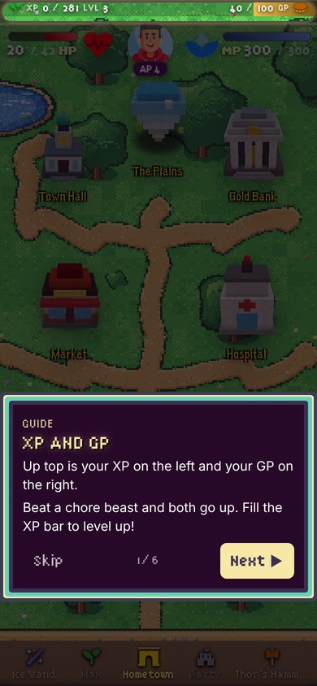
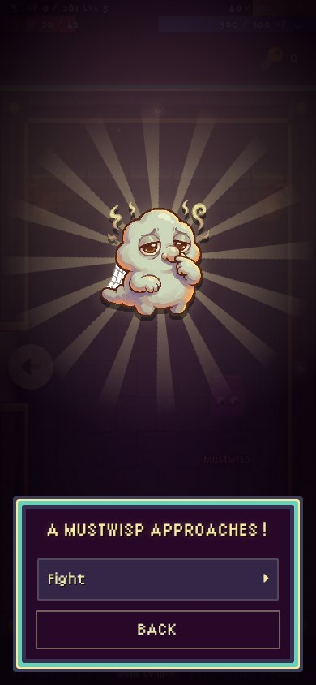
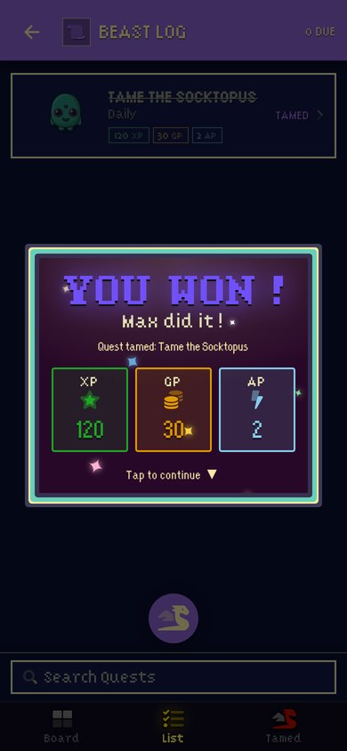
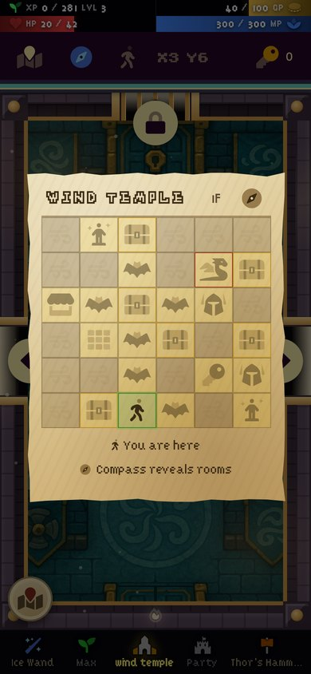

</div>

## What it is

Do It For The XP turns the household to-do list into a small role-playing game. A parent plays the **Game Master**: they set up the family, write quests ("take out the bins", "read for 20 minutes"), choose what each one pays and decide which ones need their approval. Each kid plays a **hero** with their own portal, stats and gear. Chores show up as beasts to tame on a deadline clock, finishing one pays out XP, GP (gold) and AP (ability points), and the gold buys things in town.

The look and sound are a love letter to *EarthBound*, *A Link to the Past* and *Chrono Trigger*: pixel fonts, battle swirls, chiptune music, dungeons with keys and boss doors.

This is a long-running personal project. It was started years ago and built by hand for most of its life, and it is now being taken to the finish line with the help of AI coding agents. Everything runs on the device: there is no account server, and the family's data lives in local storage.

## A quick tour

### For heroes

| | | | |
| :---: | :---: | :---: | :---: |
| 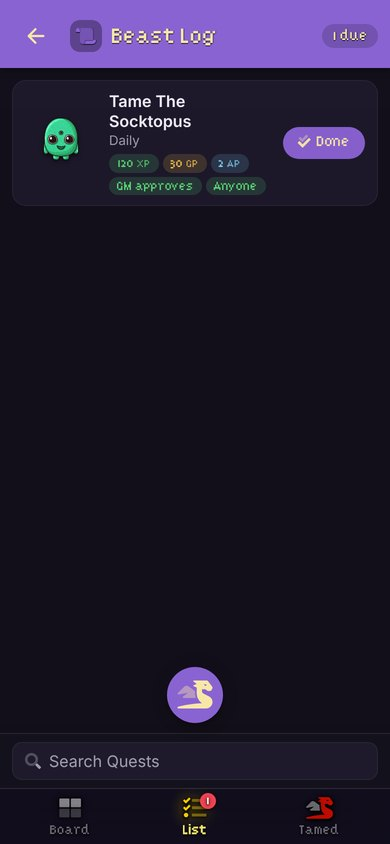 |  |  | 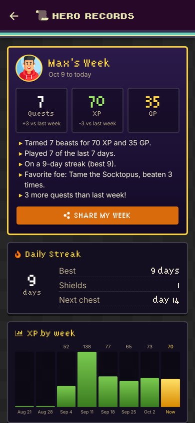 |
| **Beast Log.** Today's chores, each one a beast to tame. | **Battle.** Act before the beast's attack clock runs out. | **Rewards.** Done quests pay XP, GP and AP. | **Records.** Weekly recap, daily streak and streak shields. |
|  | 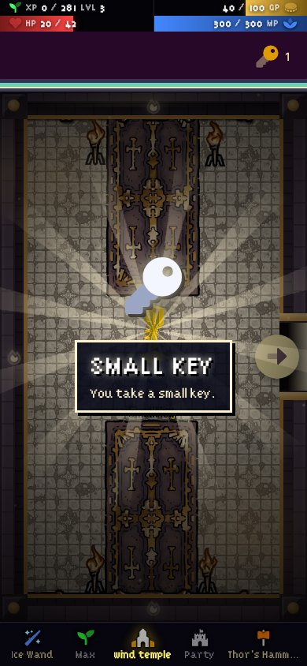 | 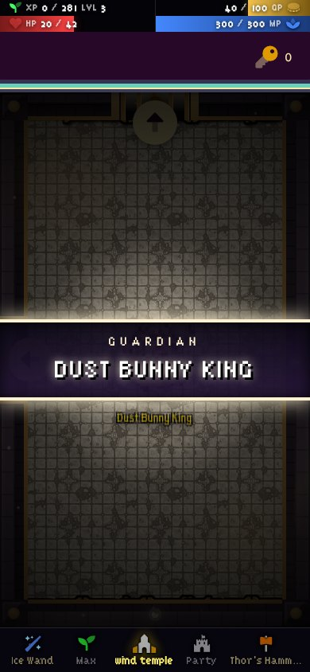 | 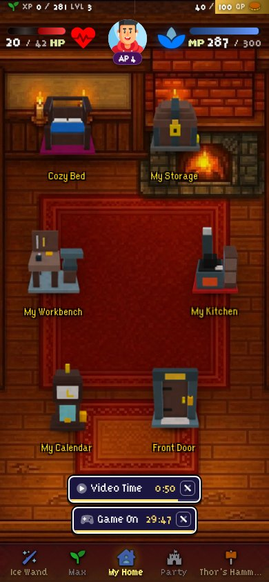 |
| **Temples.** Nine themed dungeons to explore room by room. | **Keys and loot.** Search bones, open chests, unlock doors. | **Guardians.** Each temple ends in a boss fight. | **My Home.** Furniture, storage, and timed rewards like screen time. |

Beyond that, the portal has a **Hometown** (Gold Bank, Hospital, Hotel, Accessory Shop, Town Hall), a **World Map** with nine regions (plains, forest, islands, swamps, mountains, sands, tundra, clouds, moon) each with its own shop, weather and temple, job classes that grow as the hero levels up, equipment in each hand, and a voxel hero you can dress up.

### For the Game Master

| | | | |
| :---: | :---: | :---: | :---: |
| 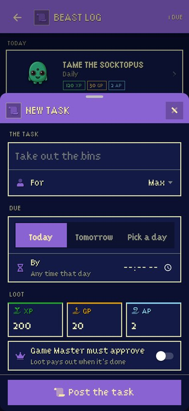 | 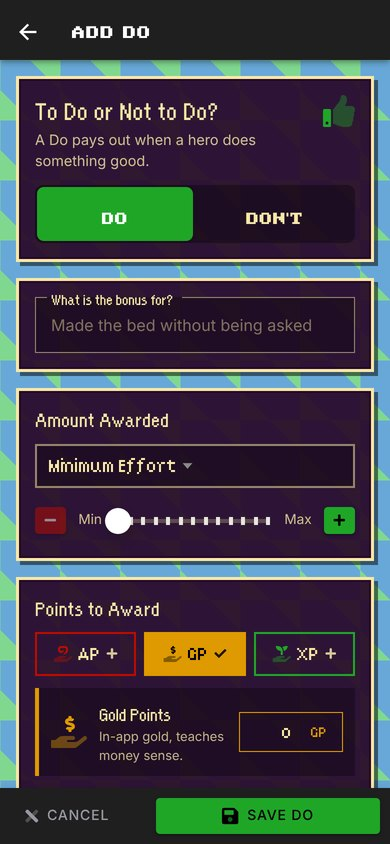 | 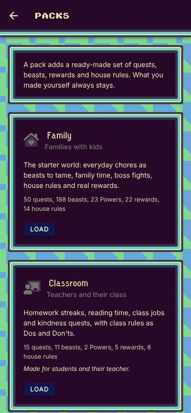 | 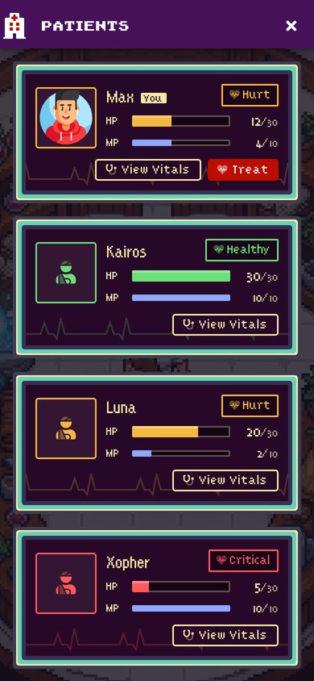 |
| **Quick task.** Post a chore for a hero with its loot and due time. | **Dos and Don'ts.** House rules that pay a bonus or cost points. | **Packs.** Load a ready-made world for a family or a classroom. | **Hospital.** See every hero's HP and MP and treat the hurt ones. |

The Game Master console also holds the **Compendium** (quests, bestiary, abilities, loot), the approvals queue, and a temple creator.

### The points

| Stat | What it does |
| --- | --- |
| **XP** | Experience. Fill the bar to level up. |
| **GP** | Gold. Spend it in shops or save it in the bank. |
| **AP** | Ability points for class skills. Free battles pay AP only. |
| **HP** | Health. A beast hits you when its attack clock runs out; heal at the Hospital or Hotel. |
| **MP** | Magic. Used by spells and equipped items. |

## Getting started

You need Node 22 and [pnpm](https://pnpm.io/) (CI uses pnpm 12).

```bash
git clone https://github.com/xopherdeep/do-it-for-the-xp.git
cd do-it-for-the-xp
pnpm install
pnpm serve            # Ionic dev server on http://localhost:8100
```

| Command | What it does |
| --- | --- |
| `pnpm serve` | Dev server with live reload on port 8100. |
| `pnpm dev` | Live reload on a device through Capacitor. |
| `pnpm build` | Production build into `dist/` (hash routing, relative paths). |
| `chemx typecheck` | TypeScript errors only. |
| `chemx lint` | ESLint, grouped by file. |
| `chemx test tests/unit/Foo.spec.ts` | One jest spec, failures only. |

The app is mobile-first; the end-to-end tests and screenshots use a 390 x 844 viewport.

### Tests run on GitHub

Quality gates go through [Chemical X](https://chemicalx.xophz.com) (`chemx`), which wraps lint, typecheck, audit and jest and prints only what matters. The full suite runs on GitHub Actions rather than on your machine:

- **Pull requests** run lint, the audit, a full typecheck, and the jest specs that depend on the files you changed (`tools/ci/pr-specs.mjs`).
- **Pushes to `master`** run `chemx verify`: the audit, typecheck and every spec.

Locally, run only the spec you are working on. The **Verify** check is required before anything merges into `master`. Every push to `master` also deploys the web build to Cloudflare Pages.

## How the code is laid out

```
src/
  app/
    Admin/              Game Master console: Compendium, approvals, temple creator
    Console/
      MyPortal/         The hero's portal: HUD, Hometown, My Home, quests, inventory
      WorldMap/         One page per region, each with a shop and a temple
      TempleGrounds/    The dungeon screen: rooms, walls, keys, items
      BattleField/      The battle screen (engine in lib/services/battle)
  lib/
    engine/             Temples, audio and other game engines
    services/           Game rules as plain modules with jest specs
    store/              Pinia stores (the hero lives in stores/user.ts)
  components/           Shared UI: bottom nav, weather FX, voxel hero
  assets/fx/            Sound effects and music slots
tools/                  Chiptune and SFX renderers, art scripts, CI helpers
tests/                  jest unit specs and Cypress e2e
```

Game rules live in small pure modules under `src/lib/services/` and screens stay thin. Most music streams as produced MP3s, with a chiptune version rendered by `tools/chiptune/` as the offline fallback.

## Tech stack

- [Vue 3](https://vuejs.org/) with TypeScript, built with Vue CLI 5 (webpack)
- [Ionic 7](https://ionicframework.com/) for the mobile shell and [Capacitor 6](https://capacitorjs.com/) for Android and iOS
- [Pinia](https://pinia.vuejs.org/) for state, persisted with localForage
- [Three.js](https://threejs.org/) for the voxel hero and furniture
- SCSS and [Tailwind CSS](https://tailwindcss.com/) for styling, Font Awesome duotone icons
- jest for unit tests, Cypress for end-to-end

## Documentation

Deeper write-ups live in the [project wiki](https://github.com/xopherdeep/do-it-for-the-xp/wiki), which is also checked out as the `docs/` submodule:

- [Architecture](https://github.com/xopherdeep/do-it-for-the-xp/wiki/Architecture) and [Codebase Structure](https://github.com/xopherdeep/do-it-for-the-xp/wiki/Codebase-Structure)
- [Battle Field Contract v2](https://github.com/xopherdeep/do-it-for-the-xp/wiki/Battle-Field-Contract-v2)
- [Temple System](https://github.com/xopherdeep/do-it-for-the-xp/wiki/Temple-System)
- [Player Stats and Leveling](https://github.com/xopherdeep/do-it-for-the-xp/wiki/Player-Stats-Leveling)
- [Roadmap](https://github.com/xopherdeep/do-it-for-the-xp/wiki/Roadmap)

## Contributing

Bug reports and ideas are welcome as [issues](https://github.com/xopherdeep/do-it-for-the-xp/issues). If you would like to send code, please open an issue first so we can talk it through. Small, focused pull requests are easiest to review, and the **Tests** check needs to be green before a merge. [CLAUDE.md](CLAUDE.md) has the project conventions in one place, for people and coding agents alike.

## License

Proprietary, all rights reserved. See [LICENSE](LICENSE).
